


&nbsp;
&nbsp;

 


I’m a first-year **B.Tech CSE (AI/ML)** student at **Bosscoder School of Technology, Bengaluru**, working toward a software engineering role at a top product company.

- **DSA:** strong with data structures and algorithms; I solve problems in **Java**
- **Web:** solid in **HTML, CSS and JavaScript**, plus **backend development**
- **AI/ML:** exploring it alongside core CS fundamentals (OS, DBMS, CN, OOP)
- **Goal:** a **FAANG/MAANG** software engineering role


 


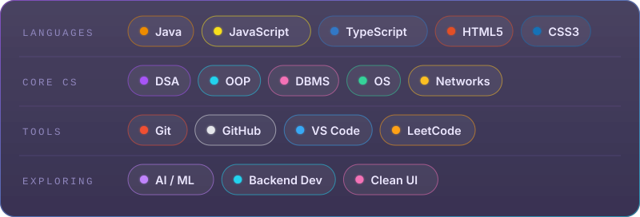

 


<a href="https://github.com/mitrasayak623-crypto/Log-lenx">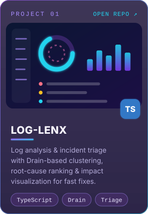</a>
<a href="https://hacktoberfestweak2.vercel.app/">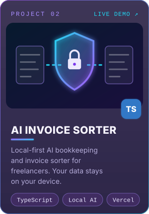</a>
<a href="https://github.com/mitrasayak623-crypto/leetcode">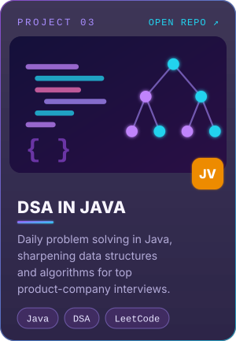</a>

<a href="https://github.com/mitrasayak623-crypto/Log-lenx">Log-LenX repo</a> &nbsp;•&nbsp;
<a href="https://hacktoberfestweak2.vercel.app/">AI Invoice Sorter live demo</a> &nbsp;•&nbsp;
<a href="https://github.com/mitrasayak623-crypto/Hacktoberfestweak2">its repo</a> &nbsp;•&nbsp;
<a href="https://github.com/mitrasayak623-crypto/leetcode">LeetCode solutions</a>

 



 


 

 


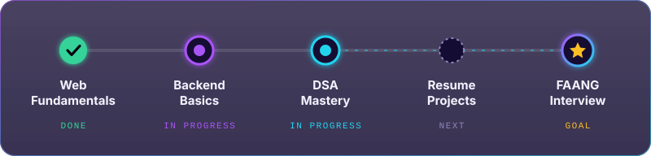

 


&nbsp;
&nbsp;

  

 Motivation — thanks for stopping by" width="100%" />

