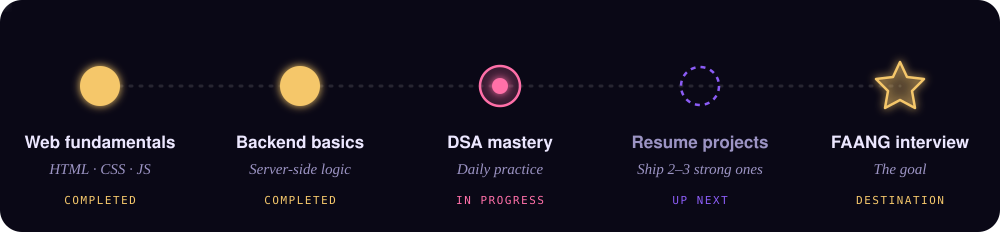

<div align="center">




<br/>

<a href="https://www.linkedin.com/in/sayak-mitra-884251380/"></a>
&nbsp;
<a href="https://github.com/mitrasayak623-crypto"></a>

</div>

<br/>



I’m a first-year **B.Tech CSE (AI/ML)** student at **Bosscoder School of Technology, Bengaluru**, working toward a software engineering role at a top product company.

- **DSA:** strong with data structures and algorithms; I solve problems in **Java**
- **Web:** solid in **HTML, CSS and JavaScript**, plus **backend development**
- **AI/ML:** exploring it alongside core CS fundamentals (OS, DBMS, CN, OOP)
- **Goal:** a **FAANG/MAANG** software engineering role

```java
public class Sayak {
    String role   = "CS Student";
    String[] loves = {"DSA", "Clean UI", "Solving problems"};
    String motto  = "Consistency > Motivation";
}
```

<br/>




<div align="center">


</div>

<br/>




<div align="center">

**Live TV Streaming App** · [Live demo](YOUR_DEMO_URL) · [Source](YOUR_REPO_URL)
**VaultLedger AI** · [Live demo](YOUR_DEMO_URL) · [Source](YOUR_REPO_URL)
**Log-LenX** · [Live demo](YOUR_DEMO_URL) · [Source](YOUR_REPO_URL)

</div>

<br/>




<br/>



<div align="center">


</div>

<br/>





<br/>



<div align="center">

<a href="https://www.linkedin.com/in/sayak-mitra-884251380/"></a>
&nbsp;
<a href="https://github.com/mitrasayak623-crypto"></a>

<br/><br/>



</div>
